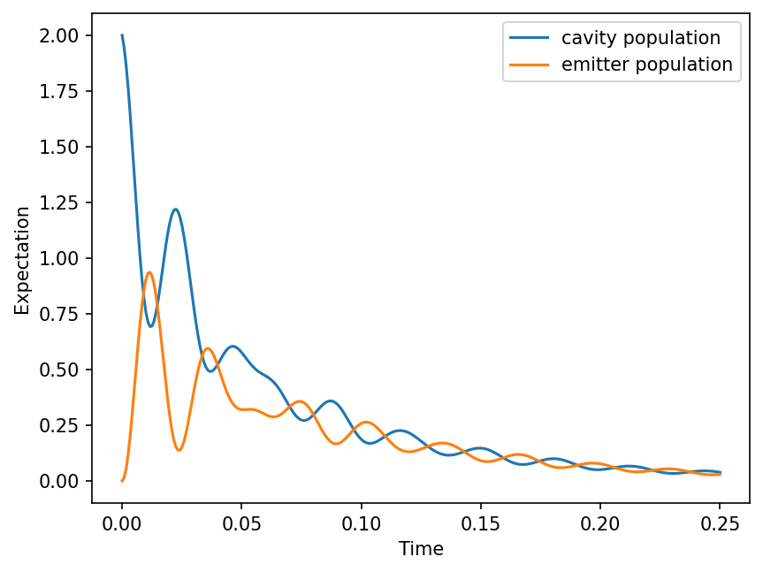
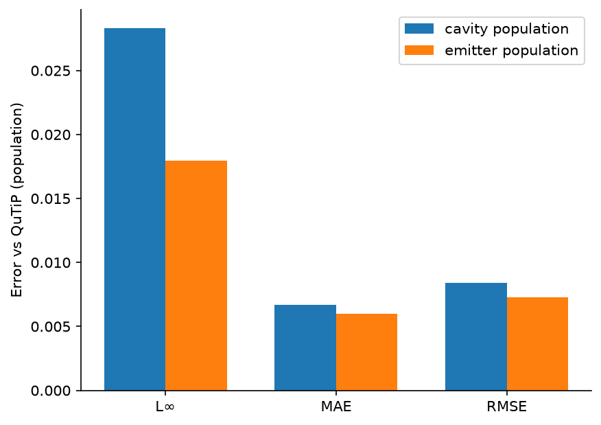

# ShadowSim.py

[](https://github.com/simsaidan/ShadowSim.py/actions/workflows/test-coverage.yml)
[](https://app.codecov.io/gh/simsaidan/ShadowSim.py)

## Overview

ShadowSim.py is an open-source Python library with two main purposes:

1. **Shadow Hamiltonian research**: support analysis and further research on shadow Hamiltonian simulation.
2. **Algorithm comparison**: make it easy to compare quantum simulation algorithms for **open** and **closed** systems.

**Note:** “Shadow” here means *shadow Hamiltonian simulation* ([Somma et al., arXiv:2407.21775](https://arxiv.org/abs/2407.21775)), **not** classical shadow tomography / randomized measurement protocols.

**When to use:** Use ShadowSim to build and inspect shadow Hamiltonians for small qubit systems, and to benchmark open- or closed-system simulation algorithms against a classical reference (e.g. QuTiP).

## Installation

The core package depends only on NumPy. QuTiP, Qiskit, Matplotlib, and Julia's PauliPropagation are optional:

```bash
python -m pip install git+https://github.com/simsaidan/ShadowSim.py.git
python -m pip install "shadowsim[qutip] @ git+https://github.com/simsaidan/ShadowSim.py.git"
python -m pip install "shadowsim[qiskit] @ git+https://github.com/simsaidan/ShadowSim.py.git"
python -m pip install "shadowsim[viz] @ git+https://github.com/simsaidan/ShadowSim.py.git"
python -m pip install "shadowsim[pauli_propagation] @ git+https://github.com/simsaidan/ShadowSim.py.git"
python -m pip install "shadowsim[all] @ git+https://github.com/simsaidan/ShadowSim.py.git"
```

| Extra | Provides |
| --- | --- |
| `qutip` | `QutipSimulator`, `run_shadow_simulation`, and QuTiP interop (`from_qutip` / `to_qutip`) |
| `qiskit` | Split JMatrix and Trotterization (`qiskit`, `qiskit-aer`, and `scipy`) |
| `viz` | Matplotlib plots (`plot_results` and benchmark figures) |
| `pauli_propagation` | `PauliPropagationBackend` (`juliacall` 0.9.36). Julia 1.10+ and the Julia package are a separate install; see [PauliPropagation](#paulipropagation) |
| `all` | `qutip`, `qiskit`, and `viz` |

The package can then be imported as `shadowsim`. Importing a backend or plot helper without its extra raises an `ImportError` that names the extra to install.

For a local development install (`uv sync --all-extras`, tests, lint, scaffolding a simulator),
see [CONTRIBUTING.md](CONTRIBUTING.md).

## Usage

Public objects are imported from their domain subpackages:
```python
from shadowsim.core import DensityOperator, Hamiltonian, Operator, State
from shadowsim.encoding import AmplitudeEncoding, AngleEncoding, ComputationalBasisEncoding, GrayEncoding
from shadowsim.shadow import ShadowHamiltonian, check_invariance
from shadowsim.simulators import QutipSimulator, SimulationResult
```

### State encoding

`shadowsim.encoding` turns classical data into a normalized `State`. Simulators take that state as `initial_state`.

```python
import numpy as np
from shadowsim.encoding import AmplitudeEncoding, AngleEncoding, ComputationalBasisEncoding, GrayEncoding

basis = ComputationalBasisEncoding(2).encode([1, 0])  # |10>
gray = GrayEncoding(2).encode([1, 0])  # |11>, Gray code of binary 2
angle = AngleEncoding().encode([np.pi / 2, 0.0])
amplitude = AmplitudeEncoding().encode([1.0, 1.0, 0.0])  # zero-padded to 2 qubits
```

`load_encoding_data` reads a 1D vector from a `.npy`, `.txt`, or `.csv` file for an encoder, as in `AmplitudeEncoding().encode(load_encoding_data("amplitudes.npy"))`.

[`examples/state_encoding.py`](examples/state_encoding.py) passes an encoded state to `QutipSimulator`.

### QuTiP interop

With the `qutip` extra, convert between QuTiP `Qobj` values and ShadowSim core types:

```python
from shadowsim.interop.qutip import from_qutip, to_qutip

H = from_qutip(qutip_H)  # → Hamiltonian
ops = [from_qutip(c) for c in c_ops]  # → Operator
psi = from_qutip(psi0)  # → State (ket)
rho = from_qutip(qutip_rho)  # → DensityOperator (Hermitian, PSD, tr≈1)
qobj = to_qutip(H)
```

Override with `kind=` when needed (e.g. `kind="hamiltonian"` for a unit-trace projector).

### PauliPropagation

`PauliPropagationBackend` returns ⟨Z⟩ and ⟨X⟩ for selected qubits of one Qiskit circuit. Install the `qiskit` extra as well, because the circuit is a `QuantumCircuit`. The `pauli_propagation` extra installs `juliacall` 0.9.36. Julia 1.10 or newer has to be available already. That juliacall release is the one that resolves next to the PauliPropagation revision below.

In the Julia project juliacall uses for this Python environment, install the OpenQASM reader:

```python
import juliacall
from juliacall import Main as jl

jl.seval("using Pkg")
jl.seval('Pkg.add(url="https://github.com/SparqleSim/PauliPropagation.jl", rev="6e8c1ae")')
```

`readqasm` on that revision accepts OpenQASM 2 / `qelib1` gates, skips `barrier` and `id`, and rejects `measure`, `reset`, and unknown gates. Qubit indexes are 0-based, and each method returns one float per index in that order. `shots` and `seed` are accepted and ignored. `max_weight` truncates Pauli weight when set, and `min_abs_coeff` defaults to `1e-10`.

```python
from qiskit import QuantumCircuit

from shadowsim.backends import PauliPropagationBackend

circuit = QuantumCircuit(1)
circuit.rx(0.4, 0)
backend = PauliPropagationBackend()
backend.z_expectations(circuit, [0], shots=1, seed=None)  # [cos(0.4)]
backend.x_expectations(circuit, [0], shots=1, seed=None)  # [0.0]
```

`RX(0.4)` applied to `|0⟩` stays in the YZ plane, so ⟨X⟩ is 0. `run_counts` raises `NotImplementedError`. The builder can run a closed Trotter circuit on this backend: product states are prepared with single-qubit gates, the circuit is transpiled into gates the reader accepts, and each requested qubit returns a Z or X expectation. Split JMatrix samples an ancilla and stays on Aer.

### Simulation results

Each backend’s `simulate()` / `run()` returns a `SimulationResult` with:

- `times`, `observables` (expectation traces), optional `states` (usually `None`)
- `seed`, `algorithm`, `runtime`, and `metadata` (software version, grid params, backend params)

Serialize and reload with `result.save(path)` / `SimulationResult.load(path)` (directory of
`times.npy`, numeric `.npz` archives, and `meta.json`). Loading does not unpickle array
files. Low-level expectation curves remain on `simulator.results`
for plotting and benchmarking.

`start()` runs that same `simulate()` call on a worker thread and returns a `SimulationJob`
immediately. Poll `status` (`pending`, `running`, `succeeded`, or `failed`). `result()` waits
for the `SimulationResult`; pass `timeout` to stop waiting while the job is still running,
which raises `TimeoutError`. If `simulate()` raised, `result()` raises that exception. Split J
and Trotter jobs count finished time points in `completed_steps` and `total_steps`. A QuTiP
job leaves both as `None`.

The following simulators are supported by the package:

| Name | Type | Can handle open systems |
| --- | --- | --- |
| Qutip simulator | classical | true |
| Split JMatrix | quantum-inspired | true |
| Trotterization | quantum-inspired | false |
| Wave matrix Lindbladization (coming soon) | — | — |
| Pauli propagation time evolution (coming soon) | — | — |

Single-qubit ⟨Z⟩ and ⟨X⟩ for one circuit are available now from
[`PauliPropagationBackend`](#paulipropagation).

### Sparse / Pauli-label shadow construction

Pass Pauli labels (or `PauliSum`s) for both the Hamiltonian and the observables so
`ShadowHamiltonian` can build `H_S` in label space—no `4^n` tomography and no
full `2^n × 2^n` matrix multiplies during construction:

```python
from shadowsim.core import Hamiltonian, OperatorSet
from shadowsim.shadow import ShadowHamiltonian

shadow = ShadowHamiltonian(
    OperatorSet(["XII", "YII", "ZII", "IIX"]),
    [Hamiltonian("XII"), Hamiltonian("IIX")],
)
assert shadow.used_sparse_pauli_path
print(shadow.H_S.shape)  # (|closure|, |closure|)
```

Dense matrices and `LocalHamiltonian` terms still work; they take the densifying
fallback (`used_sparse_pauli_path` is `False`). See also
[`examples/simple_shadow.py`](examples/simple_shadow.py).

To check whether a given operator set already satisfies the invariance property
(closed under `[H, ·]`) without building a full shadow simulation, use
`check_invariance`. It reports whether the set is closed, how many Pauli labels
must be added to close it, and whether the closed-basis `H_S` is Hermitian:

```python
from shadowsim.core import Hamiltonian, OperatorSet
from shadowsim.shadow import check_invariance

report = check_invariance(
    OperatorSet(["Z"]),
    Hamiltonian("X"),
)
assert not report.is_closed
assert report.growth == 1
assert report.added_paulis == frozenset({"Y"})
```

For practical scale limits (sparse vs dense, closure size, simulators), see
[Scalability / practical limits](#scalability--practical-limits).

## Scalability / practical limits

### Shadow construction

- Prefer Pauli labels / `PauliSum` so `ShadowHamiltonian` takes the sparse path
  (`used_sparse_pauli_path`). Cost then tracks Hamiltonian Pauli terms × closure
  size `m`, not `4^n`.
- Dense fallback (dense matrices / `LocalHamiltonian`): practical for small `n`
  (roughly ≤3–4 as historically exercised). Bottleneck is `4^n` Pauli tomography
  plus dense `2^n` linear algebra.
- Closure size `m` can grow independently of Hilbert-space dimension; `H_S` is
  always `m×m` (not `2^n×2^n`).
- Inspect cost before a long run: `ShadowHamiltonian(..., verbose=True)` prints
  Hamiltonian Pauli count, operator-set union size, and closure size.

### What works today

| Path | Practical scale today | Bottleneck |
| --- | --- | --- |
| `ShadowHamiltonian` (Pauli labels) | few-term models; `n` past ~3–4 when closure stays small | Pauli terms × closure size `m` |
| `ShadowHamiltonian` (dense / local) | small `n` (~≤3–4) | `4^n` tomography + dense mats |
| QuTiP simulator | small truncated models | stiff ODEs / Hilbert dim |
| Split JMatrix + Aer | tiny time grids / shot budgets for smoke; set `seed` for reproducible Aer shots | circuit per timestep × shots |
| Trotterization + Aer | closed systems only; tiny time grids / shot budgets; set `seed` for reproducible Aer shots | circuit per timestep × shots |

### Not yet / still heavy

GPU-backed shadows, open-system Lindblad shadow extensions, and a reduced smoke
grid for Example 2 are not provided yet. For shadow construction, use the
[sparse / Pauli-label path](#sparse--pauli-label-shadow-construction) whenever
you already have a Pauli decomposition.

## Examples

### Example 1: Exploring a simple shadow simulation

The complete example is in [`examples/simple_shadow.py`](examples/simple_shadow.py)
and can be run after `uv sync --all-extras`:
```bash
uv run python examples/simple_shadow.py
```
That example uses Pauli labels (sparse construction path) and
`run_shadow_simulation` for the reduced shadow dynamics.
Pass `verbose=True` to `run_shadow_simulation` if you want Pauli-set and
closure sizes printed.

### Example 2: Comparing a quantum algorithm against a classical solver

This is a paper-scale QuTiP vs Split JMatrix + Aer comparison (`301` time points
and a non-trivial shot budget)—expect long wall time and nontrivial Aer cost; it
is not a CI smoke test. The runnable script
[`examples/simple_algo_benchmark.py`](examples/simple_algo_benchmark.py) uses the
same scale; there is no reduced smoke grid yet. See
[Scalability / practical limits](#scalability--practical-limits).

Imagine a scenario in which you want to compare the results of a new quantum
simulation algorithm against a source of truth like QuTiP.

We build the open cavity–emitter (Tavis–Cummings–like) model with the shared
factory. Defaults match the historical Example 2 parameters; pass
`n_emitters`, `g`, `kappa`, and friends to change the physics without rewriting
operator embeddings.

```python
from shadowsim.backends import AerCircuitBackend
from shadowsim.benchmarking import Benchmark
from shadowsim.models import tavis_cummings
from shadowsim.simulators import QutipSimulator, SplitJMatrixSimulator

model = tavis_cummings()
```

Next, we create two simulators, one for the new algorithm and one for the
source of truth.

```python
# Qutip simulator
qutip_simulator = QutipSimulator(
    model.full_hamiltonians,
    model.c_ops_full,
    model.psi0,
    model.e_ops,
    num_qubits=model.num_qubits,
    total_time=0.25,
    time_steps=301,
)
# Split JMatrix simulator
splitjmatrix_simulator = SplitJMatrixSimulator(
    model.local_hamiltonians,
    model.c_ops_local,
    model.psi0,
    num_qubits=model.num_qubits,
    total_time=0.25,
    time_steps=301,
    num_steps=40,
    measurement_groups=model.measurement_groups,
    reducers=list(model.reducers),
    circuit_backend=AerCircuitBackend(shots=10000),
)
```

To easily compare results, we initialize a benchmark with a reference simulator
and one or more challengers. All simulators must share the same time grid.
We run the benchmark, which runs the underlying simulations. Numeric L∞ / L2 /
MAE / RMSE error metrics vs the reference are available via `error_metrics`.
Wall-clock time and shot budget (when the circuit backend stores `shots`) are available
via `resource_metrics`. Both are exported together by `save_error_metrics` as
`{"errors": ..., "resources": ...}`. `save_result_plot` saves a plot per
simulator and an absolute-difference plot vs the reference for each challenger.
The third figure below shows L∞, MAE, and RMSE from `error_metrics`. Those
three share a per-time-point scale.

QuTiP is deterministic. Split JMatrix estimates populations from the finite
`shots` budget on `AerCircuitBackend`, so the comparison moves run to run unless
you set `seed` (wired into Aer’s `seed_simulator`). Residual disagreement also
includes systematic split-J / Trotter bias that does not vanish with more shots.
Use a lower `shots` value on that backend for smoke checks and a higher budget
for publication figures; pass
`verbose=True` or a `progress(step, total)` callback for long-run feedback.
`workers=1` (the default) runs each time point serially. A larger `workers`
value runs those independent points on a process pool; traces stay in `tlist`
order.

```python
benchmark = Benchmark(qutip_simulator, splitjmatrix_simulator)
benchmark.run()
print(benchmark.error_metrics())
print(benchmark.resource_metrics())
metrics_path = benchmark.save_error_metrics()
paths = benchmark.save_result_plot(labels=["cavity population", "emitter population"])
for path in [metrics_path, *paths]:
    print(f"Saved: {path}")
```

**Output**

*QuTiP (reference):*



*Split JMatrix:*


*L∞, MAE, and RMSE vs QuTiP:*



### Example 3: Classical and transverse-field Ising models

[`examples/ising_chain.py`](examples/ising_chain.py) builds Ising Hamiltonians with
the shared factory and evolves a small open transverse-field chain in QuTiP.

```bash
uv run python examples/ising_chain.py
```

```python
from shadowsim.models import ising
from shadowsim.simulators import QutipSimulator

# Transverse-field Ising: H = J Σ Z_i Z_j + h Σ X_i
model = ising(
    n_qubits=4,
    J=1.0,
    h=0.5,
    field="transverse",  # or "classical" for a Z field
    topology="chain",
    boundary="open",  # or "periodic"
)

# Custom connectivity (overrides chain presets)
custom = ising(
    n_qubits=4,
    J=1.0,
    h=0.5,
    field="classical",
    edges=[(0, 1), (1, 2), (2, 3), (0, 2)],
)

simulator = QutipSimulator(
    model.full_hamiltonians,
    model.c_ops_full,  # empty; closed system
    model.psi0,
    model.e_ops,
    num_qubits=model.num_qubits,
    total_time=2.0,
    time_steps=101,
)
result = simulator.simulate()
```

Use `model.hamiltonian` or `model.pauli_sum` when you only need the combined
Hamiltonian (for example with `run_shadow_simulation`). Contiguous
nearest-neighbor ZZ terms (`|i - j| == 1`) and single-site fields are also
available as `model.local_hamiltonians`. Non-contiguous edges (periodic wrap
or custom long-range couplings) appear only in the full-space operators.

### Example 4: Encoding classical data as an initial state

[`examples/state_encoding.py`](examples/state_encoding.py) prepares computational-basis, angle, and amplitude states, then evolves the amplitude state with QuTiP.

```bash
uv run python examples/state_encoding.py
```

## Documentation

- [API / site docs](https://simsaidan.github.io/ShadowSim.py/) (`docs/`; preview with `uv sync --group docs --extra qutip --extra qiskit && uv run mkdocs serve`)
- [Contributing](CONTRIBUTING.md)

## Contributing

See [CONTRIBUTING.md](CONTRIBUTING.md) for development setup, tests, linting,
simulator scaffolding, and pull-request guidelines.

## License

This project is licensed under the MIT License. See `LICENSE` for details.

## Citing

DOI coming soon.

## References

See the [documentation bibliography](https://simsaidan.github.io/ShadowSim.py/references/).
